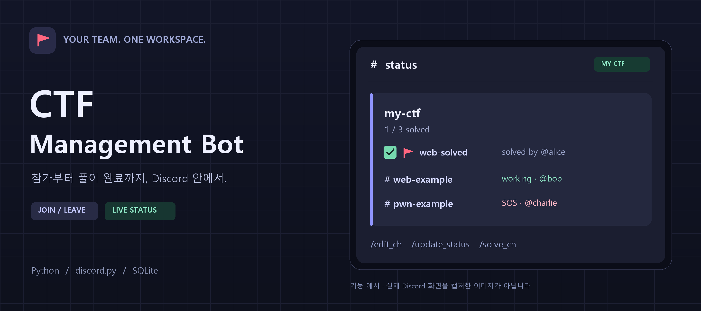
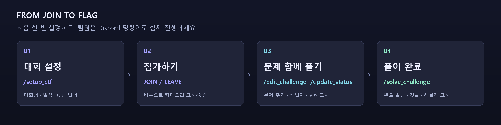

<a id="readme-top"></a>

<div align="center">
  

  <h1>ctf-management-bot</h1>
  <p><strong>참가부터 풀이 완료까지, 팀의 CTF 진행 상황을 한곳에서.</strong></p>
  <p>
    <a href="#getting-started"><strong>설치 시작하기 »</strong></a>
    <br><br>
    <a href="#configuration">처음 설정할 값</a> ·
    <a href="#usage">명령어 안내</a> ·
    <a href="https://github.com/RatelXD/ctf-management-bot/issues">버그 제보 · 기능 제안</a>
  </p>
  <p>
    <a href="https://github.com/RatelXD/ctf-management-bot/actions/workflows/tests.yml"></a>
    <a href="https://www.python.org/"></a>
    <a href="https://discordpy.readthedocs.io/"></a>
    <a href="https://www.sqlite.org/"></a>
    <a href="https://github.com/RatelXD/ctf-management-bot/stargazers"></a>
  </p>
</div>

<details>
  <summary><strong>목차 · 필요한 곳으로 바로 이동</strong></summary>

  - [프로젝트 소개](#about-the-project)
  - [처음 설정할 값](#configuration)
  - [설치와 실행](#getting-started)
  - [대회 만들기와 삭제](#create-event)
  - [문제와 풀이 관리](#usage)
  - [저장과 운영](#operations)
  - [무료 실행 방법](#hosting)
  - [검증](#testing)
  - [기여와 문의](#contributing)
  - [참고한 자료](#acknowledgments)

</details>

<a id="about-the-project"></a>

## 프로젝트 소개

CTF 참가 버튼, 문제별 채널, 참가자별 작업 상태와 풀이 현황을 관리하는 Discord 봇입니다. 관리 권한이 있는 기존 Discord 서버에 초대해 사용할 수 있으며 내 PC에서 실행할 수 있습니다.

**대회명은 사용자가 `/setup_ctf`에서 정합니다.** 특정 대회나 참가 역할이 코드에 고정되어 있지 않습니다. 아래의 `my-ctf`는 예시이므로 운영할 대회명으로 바꾸세요.

| 참가 관리 | 문제별 협업 | 풀이 현황 |
| --- | --- | --- |
| 버튼 하나로 참가·탈퇴 | 문제 채널과 생성자 기록 | 해결자만 남는 `#📊│dashboard` 현황판 |
| 역할로 카테고리 표시·숨김 | 🔨 푸는 중 · 🆘 도움 요청 | 완료 알림과 🚩 채널명 |
| 재시작 후에도 버튼 유지 | 참여자별 작업 상태 관리 | SQLite로 기록 보존 |

<p align="center">
  
</p>

**기술 구성:** Python 3.11+ · discord.py 2.x · SQLite · Docker Compose(선택)

<p align="right"><a href="#readme-top">맨 위로 ↑</a></p>

<a id="configuration"></a>

## 처음 설정할 값 한눈에 보기

| 사용자가 정할 값 | 입력 위치 | 필수 여부 | 입력 방법 / 예시 |
| --- | --- | --- | --- |
| 봇 이름 | Discord Developer Portal → 애플리케이션 생성 | 필수 | 서버에서 사용할 봇 이름을 자유롭게 지정 |
| 사용할 Discord 서버 | 봇 초대 화면 | 필수 | 본인이 관리하는 서버 선택 |
| 봇 토큰 | `.env` → `DISCORD_TOKEN` | 필수 | Developer Portal의 Bot 메뉴에서 발급한 토큰 |
| Discord 서버 ID | `.env` → `DISCORD_GUILD_ID` | 권장 | 개발자 모드를 켜고 서버 우클릭 → 서버 ID 복사 |
| 대회명 | Discord → `/setup_ctf`의 `name` | 필수 | `my-ctf` → 실제 대회명으로 변경 |
| 시작 시각 | `/setup_ctf`의 `start` | 필수 | `2026-11-01T20:00+09:00` → 실제 시작 시각 |
| 종료 시각 | `/setup_ctf`의 `end` | 필수 | `2026-11-03T20:00+09:00` → 실제 종료 시각 |
| 대회 사이트 주소 | `/setup_ctf`의 `url` | 필수 | `https://example.com` → 실제 대회 URL |
| 데이터 저장 경로 | `.env` → `DATABASE_PATH` | 선택 | 기본값 `data/ctf.sqlite3`를 그대로 사용 가능 |

**직접 만들어 둘 필요가 없는 항목**은 다음과 같습니다. 대회명을 `my-ctf`로 입력했다면:

| 항목 | 만들어지는 이름 / 내용 | 이름을 정하는 방식 |
| --- | --- | --- |
| 참가 역할 | `⚔️my-ctf⚔️` | 대회 카테고리명과 동일 |
| 비공개 카테고리 | `⚔️my-ctf⚔️` | 입력한 대회명 양 끝에 ⚔️ |
| 참가 버튼 | `my-ctf (for everyone)` | 입력한 대회명으로 자동 생성 |
| 참가 안내 채널 | `#ctf-join` | 고정 이름, 카테고리 밖에 같은 채널이 있으면 재사용 |
| 대회 안내 채널 | `#📢│announcements` | 대회 카테고리 안에 고정 이름으로 생성 |
| 풀이 현황 채널 | `#📊│dashboard` | 대회 카테고리 안에 고정 이름으로 생성 |
| 일반 대화 채널 | `#💬│general` | 참가자 대화와 문제 생성용 |
| 문제 채널 | `문제명` 또는 `분야-문제명` | `/edit_challenge`의 `name`과 `category`로 지정 |

대회명을 `My CTF`로 입력하면 참가 역할과 카테고리가 모두 `⚔️My CTF⚔️`으로 만들어집니다. 기존 `CTF-my-ctf` 역할도 업데이트 후 카테고리명에 맞춰 이름만 바뀌며 참가자는 유지됩니다. **참가 역할명과 카테고리명을 별도로 지정하는 옵션은 현재 없습니다.** 채널 이름 `ctf-join`, `📢│announcements`, `📊│dashboard`, `💬│general`도 현재 `.env` 설정 항목이 아닙니다.

설정 순서: **① 봇 생성·초대 → ② `.env` 작성·봇 실행 → ③ Discord에서 `/setup_ctf` → ④ 참가 버튼 → ⑤ 문제 추가**

<p align="right"><a href="#readme-top">맨 위로 ↑</a></p>

<a id="getting-started"></a>

## 설치와 실행

### 준비물

| 준비물 | 용도 |
| --- | --- |
| Python 3.11 이상 · Git | 코드 다운로드와 봇 실행 |
| 관리 권한이 있는 Discord 서버 | 봇 초대와 대회 생성 |
| Discord 애플리케이션과 봇 토큰 | Discord API 연결 |

### 1. 봇 생성과 초대

1. [Discord Developer Portal](https://discord.com/developers/applications)에서 **New Application**을 만들고 Bot 메뉴에서 봇 토큰을 발급합니다.
2. Installation 또는 OAuth2 URL Generator에서 **서버 설치(Guild Install)**, `bot`, `applications.commands`를 선택합니다.
3. 봇 권한: **Manage Channels, Manage Roles, View Channels, Send Messages, Embed Links, Read Message History**. Administrator는 필요 없습니다.
4. 초대 링크를 열어 사용할 Discord 서버에 초대합니다.
5. 서버 설정 → 역할에서 **봇 역할을 CTF 참가 역할보다 위로** 올려 둡니다. 새 참가 역할은 봇이 생성합니다. 자동으로 위에 배치되지만 나중에 순서를 바꾸면 참가 버튼이 실패할 수 있습니다.

Message Content Intent, Server Members Intent 등 privileged intent는 켤 필요가 없습니다. 토큰은 `.env`에만 보관하고 공개 저장소에 올리지 마세요. 기존 사용자 계정 토큰은 사용하지 않습니다.

### 2. Windows에서 실행

Python 3.11 이상과 Git을 설치한 뒤 PowerShell에서 프로젝트를 내려받습니다. 이미 다운로드했다면 해당 폴더에서 다음 설치 단계부터 진행하세요.

```powershell
git clone https://github.com/RatelXD/ctf-management-bot.git
cd ctf-management-bot
```

가상환경을 만들고 설정 파일을 엽니다.

```powershell
python -m venv .venv
.\.venv\Scripts\python.exe -m pip install -r requirements.txt
Copy-Item .env.example .env
notepad .env
```

`.env`에서 아래 두 값을 본인 값으로 바꾸고 저장합니다. 대회명이나 참가 역할명은 이 파일에 넣지 않습니다.

```dotenv
DISCORD_TOKEN=여기에_발급받은_봇_토큰
DISCORD_GUILD_ID=여기에_Discord_서버_ID
DATABASE_PATH=data/ctf.sqlite3
```

`DISCORD_GUILD_ID`에 서버 ID를 넣으면 그 서버에 명령어를 즉시 등록합니다. 비우면 전역 등록으로 전파에 시간이 걸릴 수 있습니다. 실행 중 `.env`를 수정했다면 봇을 재시작하세요. 전역/서버 등록을 전환하면 예전 등록 명령이 남을 수 있으므로 운영에서는 한 방식을 유지하세요.

```powershell
.\.venv\Scripts\python.exe bot.py
```

Ready 로그가 나오면 Discord에서 아래 설정 명령을 실행합니다. PowerShell 창을 닫거나 PC를 끄면 봇도 꺼집니다. 공개 IP, 포트 포워딩, 웹 도메인은 필요 없습니다.

<p align="right"><a href="#readme-top">맨 위로 ↑</a></p>

<a id="create-event"></a>

## 대회 만들기와 삭제

서버 관리(Manage Server) 권한이 있는 사람이 **Discord 서버의 텍스트 채널에서** `/setup_ctf`를 선택합니다. 새 대회를 만들 때는 네 옵션을 모두 입력하고, 기존 대회를 수정할 때는 `name`과 바꿀 항목만 입력합니다. 터미널에 입력하는 명령이 아닙니다.

| 옵션 | 넣을 값 | 주의사항 |
| --- | --- | --- |
| `name` | 운영할 대회명 | 참가 역할·카테고리·버튼 이름의 기준이 됨 |
| `start` | 실제 시작 일시 | `연도-월-일T시:분+09:00` 형식. `+09:00`은 한국 시간 |
| `end` | 실제 종료 일시 | 시작보다 늦은 시각. 시간대도 반드시 포함 |
| `url` | 실제 대회 사이트 주소 | `https://` 또는 `http://`로 시작 |

아래는 **형식 확인용 예시**입니다. 대회명·날짜·URL을 모두 실제 값으로 바꿔 입력하세요.

```text
/setup_ctf name:my-ctf start:2026-11-01T20:00+09:00 end:2026-11-03T20:00+09:00 url:https://example.com
```

실행하면 위의 자동 생성 표에 나온 역할·카테고리·채널이 만들어집니다. `#ctf-join`의 카드에는 Start, End, URL과 참가/탈퇴 버튼이 표시됩니다.

### 기존 대회 수정

`/setup_ctf name:`에 일부 이름을 입력하면 기존 대회가 자동완성 목록에 뜹니다. 수정할 대회를 선택한 뒤 `start`, `end`, `url` 중 바꿀 항목만 입력하세요. 대회명이나 `⚔️대회명⚔️` 형태의 카테고리명을 직접 붙여 넣어도 됩니다. 생략한 값은 유지됩니다.

```text
/setup_ctf name:my-ctf url:https://new.example.com
/setup_ctf name:my-ctf end:2026-11-04T20:00+09:00
```

시작 시각 옵션은 `start`, 종료 시각 옵션은 `end`입니다. 일부 시각만 수정해도 종료가 시작보다 늦은지 확인합니다. `name`만 입력하고 수정할 항목을 생략하면 안내 메시지가 표시됩니다.

새 대회는 기존 대회와 다른 이름으로 만들고 `start`, `end`, `url`을 모두 입력해야 합니다. 기존 대회명을 바꾸는 전용 명령은 없습니다. 자동완성에서 고른 대회를 수정할 때도 원래 대회명과 역할·채널 ID는 유지됩니다.

### 대회 전체 삭제

서버 관리 권한이 있는 사람만 실행할 수 있습니다. 삭제할 카테고리 밖의 채널에서 입력하세요.

```text
/remove_ctf name:my-ctf
```

`name`에 대회명의 일부를 입력하면 비슷한 CTF 카테고리가 자동완성 목록에 뜹니다. 목록에서 선택하거나 `⚔️my-ctf⚔️`처럼 카테고리명을 그대로 붙여 넣어도 됩니다. 대소문자와 앞뒤 공백은 무시합니다. 비슷한 이름만 입력했다고 바로 삭제되지는 않으며 여러 대회가 일치하면 목록에서 하나를 골라야 합니다.

이 명령은 해당 카테고리 안의 모든 채널과 대화, 카테고리, 참가 역할, 참가 카드, SQLite의 대회·문제 기록을 삭제합니다. 공유 `#ctf-join` 채널과 다른 대회는 남습니다. 삭제 도중 권한 오류가 나면 봇의 권한과 역할 순서를 확인한 뒤 같은 명령을 다시 실행하세요.


대회를 여러 개 만들면 `#ctf-join`에 대회별 카드와 버튼이 생깁니다. 카테고리 밖의 기존 `#ctf-join`이 있으면 재사용하므로, 그 채널은 일반 참가자에게 보이고 봇이 메시지를 쓸 수 있어야 합니다.

버튼을 누르면 **그 사람에게만 보이는 응답**과 함께 역할을 부여합니다. 다시 누르면 역할을 회수하고 떠났다고 응답합니다. 카테고리와 문제 채널은 참가자에게 보였다가 숨겨집니다. 채널이나 기록을 삭제하지 않으므로 다른 참가자에게 영향이 없습니다. Discord의 Administrator 권한이 있는 사람과 서버 소유자는 권한 우회로 카테고리를 계속 볼 수 있습니다.

<p align="right"><a href="#readme-top">맨 위로 ↑</a></p>

<a id="usage"></a>

## 문제와 풀이 관리

### 명령어 한눈에 보기

| 명령어 | 실행할 곳 | 사용할 수 있는 사람 |
| --- | --- | --- |
| `/setup_ctf` | 서버의 텍스트 채널 | 서버 관리자 |
| `/remove_ctf name:대회명` | 삭제할 카테고리 밖의 텍스트 채널 권장 | 서버 관리자 |
| `/edit_challenge name:문제명` | 대회 카테고리의 텍스트 채널 | 참가자·서버 관리자 |
| `/edit_challenge category:pwn` | 기존 문제 채널 | 문제 생성자·서버 관리자 |
| `/edit_challenge erase:True` | 삭제할 문제 채널 | 서버 관리자 |
| `/update_status` | 문제 채널 | 참가자·서버 관리자 |
| `/solve_challenge flag:FLAG{...}` | 문제 채널 | 참가자·서버 관리자 |
| `/unsolve_challenge` | 문제 채널 | 해결자·서버 관리자 |

여기서 서버 관리자는 **서버 관리(Manage Server / Manage Guild) 권한이 있는 사람**을 뜻합니다. Administrator 권한이 있는 사람과 서버 소유자도 사용할 수 있습니다. 이전 명령어 `/edit_ch`, `/solve_ch`, `/unsolve_ch`는 각각 `/edit_challenge`, `/solve_challenge`, `/unsolve_challenge`로 바뀌었습니다.

### 문제 만들기

참가 버튼을 누른 뒤 해당 대회의 `#💬│general` 또는 `#📢│announcements`에서 실행하세요.

```text
/edit_challenge name:runner
/edit_challenge name:example category:web
```

첫 번째 명령은 `runner`, 두 번째 명령은 `web-example` 채널을 만듭니다. 채널명은 소문자와 하이픈으로 정리됩니다. 문제 안내 카드의 `Added by`에는 생성자가 기록되고 나중에 수정해도 이 기록은 유지됩니다.

### 문제 이름과 분야 수정

기존 문제 채널 안에서 `/edit_challenge`를 실행하면 그 문제를 수정합니다. 수정은 문제 생성자와 서버 관리자만 할 수 있습니다. 새 문제를 더 만들려면 `#💬│general`로 이동하세요.

옵션은 `name` → `category` → `erase` 순서입니다. `description` 옵션은 없습니다.

| 옵션 | 동작 |
| --- | --- |
| `name` | 문제 이름 변경. 새 문제를 만들 때는 필수이며, 기존 문제를 수정할 때는 생략 가능 |
| `category` | 분야 추가·변경. 생략하면 기존 분야 유지 |
| `erase` | `True`를 선택하면 현재 문제 삭제. 서버 관리자만 사용 가능 |

분야만 추가하려면 문제 채널 안에서 다음과 같이 입력합니다.

```text
/edit_challenge category:pwn
```

`runner`는 `pwn-runner`로 바뀝니다. 이후 `category:web`으로 수정하면 `web-runner`가 됩니다. 기존 문제 채널 밖에서는 `name` 없이 문제를 만들 수 없습니다.

### 문제 하나 삭제

삭제할 문제 채널 안에서 서버 관리자가 실행합니다.

```text
/edit_challenge erase:True
```

삭제할 때는 `name`과 `category`를 함께 입력하지 마세요. 해당 문제의 채널·대화·저장 기록이 삭제되고 dashboard의 문제 목록과 해결 수가 갱신됩니다. 대회 전체를 삭제하려면 `/remove_ctf`를 사용합니다. 별도의 `/remove_challenge` 명령은 없습니다.

Discord에서 문제 채널을 직접 삭제한 경우에도 봇이 해당 기록을 정리합니다. 봇이 꺼진 동안 삭제한 문제는 재시작 후 Discord API로 삭제 여부를 확인합니다. 이전에 dashboard에 남은 `알 수 없음` 항목도 이때 정리됩니다.

### 작업 상태와 풀이 완료

문제 채널 안에서 다음 명령을 실행하세요.

| 명령 | 동작 |
| --- | --- |
| `/update_status status:working` | 내 이름을 🔨 푸는 중으로 표시 |
| `/update_status status:stuck` | 내 이름을 🆘 막힘·도움 필요 SOS로 표시 |
| `/update_status status:stopped` | 내 이름을 작업자 목록에서 제거 |
| `/solve_challenge flag:FLAG{...}` | 실행자를 해결자로 기록하고 플래그 공개. 채널명 앞에 `🚩-` 추가 |
| `/unsolve_challenge` | 풀이 완료 취소, `🚩-` 제거, 작업자 목록 초기화 |

여러 사람이 working 또는 stuck 상태를 등록할 수 있습니다. 문제가 해결되면 작업자 목록을 비우고 해결자 한 명만 표시합니다. 이미 해결된 문제에는 solve나 작업 상태 변경을 다시 적용할 수 없습니다. 풀이 취소는 해결자 또는 서버 관리자만 할 수 있습니다.

**플래그는 대회 사이트에서 먼저 인증하세요.** 봇은 정답을 검증하거나 대회에 자동 제출하지 않습니다. `/solve_challenge`는 팀 내 완료 기록용이며 입력한 플래그는 비공개 문제 채널에서 참가자들에게 공개됩니다.

`/unsolve_challenge`의 응답은 다음과 같습니다.

> 풀이를 취소했습니다. 다시 /update_status로 작업자를 등록할 수 있습니다.

기존 채팅에 남은 풀이 완료 알림은 삭제하지 않습니다.

### dashboard와 안내 채널

`#📢│announcements`에는 대회 정보와 명령어 가이드를 표시합니다. “봇은 정답을 검증하지 않습니다.”는 별도 줄로 안내합니다. `#💬│general`은 참가자 대화와 새 문제 생성에 쓰면 됩니다.

`#📊│dashboard`는 서버 관리자와 봇만 메시지를 보낼 수 있습니다. 명령어 가이드는 채널 주제에서 제외하고 풀이 현황을 다음과 같이 표시합니다. 미해결 문제 앞에는 체크 표시가 붙지 않습니다.

```text
📋 my-ctf — 1 / 3 solved

✅ #🚩-web-solved · solved by @해결자
#web-example · 🔨 @작업자 · 🆘 @도움필요
#pwn-example · 미해결
```

### dashboard는 바뀌었는데 채널명은 그대로라면

dashboard는 보통 5초 안에 갱신됩니다. 채널명 변경은 별도 요청이어서 분야 수정, solve, unsolve를 짧은 시간에 반복하면 Discord의 요청 제한에 걸릴 수 있습니다. 이 경우 dashboard의 체크 표시는 먼저 바뀌고 채널명의 `🚩-`는 나중에 제거됩니다.

봇은 진행 중인 이름 변경이 끝난 뒤 최신 풀이 상태를 다시 확인합니다. Discord가 `429` 응답과 대기 시간을 반환하면 그 시간을 기다려야 합니다. 실제 운영 로그에서는 약 9분의 대기가 확인됐습니다. 봇을 재시작해도 Discord의 제한은 초기화되지 않습니다. [Discord 공식 요청 제한 안내](https://support-dev.discord.com/hc/en-us/articles/6223003921559-My-Bot-is-Being-Rate-Limited)

지연이 계속되면 서버 로그의 `429`와 `Retrying in ... seconds`를 확인하세요.

```sh
journalctl -u ctf-management-bot -n 80 --no-pager
```

<p align="right"><a href="#readme-top">맨 위로 ↑</a></p>

<a id="operations"></a>

## 저장과 운영

SQLite `data/ctf.sqlite3`에 대회·채널 ID, 생성자, 작업 상태, 해결자, 플래그, 메시지 ID를 저장합니다. 봇을 재시작해도 참가 버튼과 저장 기록은 유지됩니다. **봇 인스턴스는 하나만 실행하세요.** 백업할 때는 봇을 종료한 뒤 `data` 폴더를 복사합니다.

삭제 방법에 따라 정리하는 범위가 다릅니다.

| 삭제 방법 | 정리하는 범위 |
| --- | --- |
| `/remove_ctf name:대회명` | 카테고리 안의 모든 채널·대화, 카테고리, 참가 역할·카드, 대회·문제 기록 |
| `/edit_challenge erase:True` | 현재 문제 채널·대화와 해당 문제 기록 |
| Discord에서 문제 채널 직접 삭제 | 해당 문제 기록과 dashboard 항목 |
| Discord에서 CTF 카테고리 직접 삭제 | 해당 대회·문제 기록과 참가 카드. 남은 하위 채널과 참가 역할은 유지 |

봇이 꺼진 동안 삭제한 카테고리와 문제 채널도 재시작 후 확인합니다. 수동 삭제한 역할은 자동으로 복원하지 않습니다.

### 기존 설치 업데이트

서버에서 코드를 업데이트하고 서비스를 재시작합니다. 기존 SQLite 파일은 유지하세요.

```sh
cd /root/cert-ctf/ctf-management-bot
git pull --ff-only
systemctl restart ctf-management-bot
journalctl -u ctf-management-bot -n 30 --no-pager
```

처음 업데이트하면 기존 카테고리는 `⚔️대회명⚔️`으로 바뀌고 기본 채널명과 dashboard 권한도 갱신됩니다. `💬│general`이 없으면 새로 만듭니다. 기존 채널을 이름만 바꾸므로 메시지와 문제 기록은 유지됩니다. 기존 문제의 분야 접두사는 해당 문제 채널에서 `/edit_challenge category:web`으로 적용할 수 있습니다. 기존 참가 역할도 카테고리명과 같아지며 참가자는 그대로 유지됩니다. 슬래시 명령의 새 이름과 옵션도 재시작할 때 동기화됩니다.

Docker를 쓸 수 있는 PC/VM에서는:

```sh
docker compose up -d --build
docker compose logs -f
```

데이터를 호스트의 `./data` 폴더에 보관하고 재부팅 후 자동 재시작하도록 설정했습니다.

<details>
<summary><strong>폴더 구성</strong></summary>

```text
ctf-management-bot/
├── bot.py                      # Discord 명령어 · 버튼 · 상태판
├── core.py                     # 상태 관리 · SQLite 저장
├── .env.example                # 복사해서 사용할 환경 설정 예시
├── compose.yaml                # Docker 실행 설정
├── docs/assets/                # README 배너와 사용 흐름 그림
├── scripts/render_readme_assets.py  # 그림 재생성 도구 (Pillow 필요)
└── tests/                      # 상태 전이 · 명령어 · 버튼 테스트
```

</details>

<p align="right"><a href="#readme-top">맨 위로 ↑</a></p>

<a id="hosting"></a>

## 무료 실행 방법

2026-11-01 공식 문서 확인 기준:

- **가장 간편한 무료 방법: 내 PC에서 실행.** 위 명령으로 실행하면 되고 PC가 켜져 있어야 합니다. 대회 기간에만 켜 두는 방식에 적합합니다.
- **PC를 끄고 계속 실행: Oracle Cloud Always Free VM 등 상시 실행 가능한 VM.** [공식 안내](https://docs.oracle.com/en-us/iaas/Content/FreeTier/freetier_topic-Always_Free_Resources.htm)를 확인해 무료 대상 인스턴스를 만들고 이 폴더와 `.env`를 옮긴 뒤 Docker Compose로 실행할 수 있습니다. 계정 가입과 초기 서버 설정이 필요하고, 무료 자원 가용성과 유휴 인스턴스 회수 조건이 있습니다.
- **Render 무료 Web Service:** [공식 제한](https://render.com/docs/free)에 따르면 유휴 중단과 로컬 SQLite 소실이 있습니다. 이 봇은 지속 실행 프로세스와 영속 디스크가 필요하므로 그대로 올릴 배포 대상에 맞지 않습니다. 무료 Background Worker도 제공하지 않습니다.

그 밖의 호스팅을 선택할 때는 일반 Python 프로세스 또는 Docker 컨테이너를 상시 실행하고 데이터 폴더를 유지할 수 있는지 확인하세요.

<p align="right"><a href="#readme-top">맨 위로 ↑</a></p>

<a id="testing"></a>

## 검증

```powershell
.\.venv\Scripts\python.exe -m unittest discover -s tests -v
```

실제 토큰 없이 실행하는 테스트는 현재 46개입니다. 상태 전이, SQLite 재시작 보존, 상태판 분할, 명령어 옵션과 관리자 권한, 자동완성, 대회 정보 일부 수정과 역할명 동기화, 분야만 수정하기, 삭제 동기화, 채널명 변경 중 solve·unsolve 처리, 참가 버튼과 메시지 복구를 검사합니다. 실제 Discord 서버에서는 초대 후 아래 동작을 확인하세요.

1. 일반 계정으로 참가 → 카테고리 보임 → 재클릭으로 숨김 → 재참가
2. `#💬│general`에서 문제 생성 후 Added by 확인
3. 두 계정으로 working/stuck → 둘 다 상태판 표시, stopped → 해당 사람만 사라짐
4. solve → 완료 알림·해결자·🚩, unsolve → ✅·🚩 제거
5. 문제 채널에서 `name` 없이 분야만 추가·변경
6. 일반 참가자의 `erase:True` 거부, 관리자의 문제 삭제 후 목록·해결 수 갱신
7. `/remove_ctf` 자동완성, 카테고리명 붙여 넣기, 선택한 대회만 삭제
8. 문제 채널 직접 삭제 후 `알 수 없음` 항목 제거
9. 봇 재시작 후 기존 참가 버튼과 상태판 유지

실제 Discord API 연동은 봇 토큰과 테스트 서버가 있어야 검증할 수 있습니다.

<p align="right"><a href="#readme-top">맨 위로 ↑</a></p>

<a id="contributing"></a>

## 기여와 문의

버그는 [Issues](https://github.com/RatelXD/ctf-management-bot/issues)에 실행 환경과 재현 방법을 함께 남겨 주세요. 기능 제안도 같은 곳에서 받습니다. 코드 변경은 저장소를 Fork한 뒤 브랜치를 만들어 Pull Request로 제안할 수 있습니다.

프로젝트 관리: [@RatelXD](https://github.com/RatelXD) · [저장소](https://github.com/RatelXD/ctf-management-bot)

<a id="acknowledgments"></a>

## 참고한 자료

- [Best-README-Template](https://github.com/othneildrew/Best-README-Template) — 중앙 헤더, 배지, 접이식 목차와 섹션 구성
- [discord.py](https://discordpy.readthedocs.io/) — Discord 봇 라이브러리
- [Shields.io](https://shields.io/) — README 기술 배지

배너와 사용 흐름 그림은 이 프로젝트를 위해 제작했습니다. 배너 속 화면은 기능을 설명하기 위한 예시입니다.

<p align="right"><a href="#readme-top">맨 위로 ↑</a></p>
